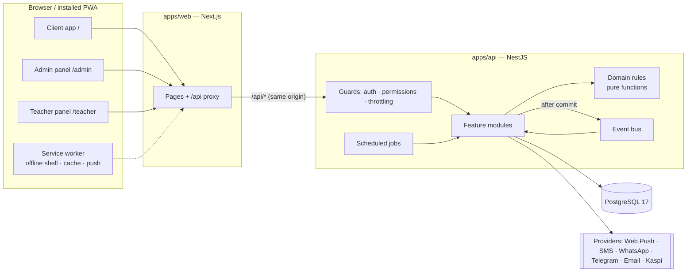

# Architecture

## Overview

- The **web app** serves all three interfaces and proxies `/api/*` to the API, so the
  browser only ever talks to one origin. The refresh-token cookie is therefore
  first-party (`SameSite=Strict`, `httpOnly`) and no CORS is involved.
- The **API** owns every business rule. The web app never decides whether a booking,
  cancellation or payment is allowed; it shows what the API returns (e.g. each session
  carries a `bookability` object computed for the viewer).
- **PostgreSQL** is the source of truth, including constraints that make illegal states
  unrepresentable (see [DATABASE.md](DATABASE.md)).

## API (apps/api)

### Layers

| Layer | Location | Responsibility |
| --- | --- | --- |
| HTTP | `src/modules/*/*.controller.ts`, `dto/` | Routing, validation (class-validator, whitelist), OpenAPI metadata, permission declarations |
| Application services | `src/modules/*/*.service.ts` | Use cases in transactions: lock rows, check rules, write, audit, publish events |
| Domain rules | `src/domain/` | Pure, unit-tested functions: cancellation deadlines, session status, level tolerance, membership selection/expiry, booking policy, recurrence |
| Infrastructure | `src/prisma`, `src/modules/messaging`, `src/modules/payments/providers`, `src/modules/files` | Database access, row locks, providers, storage |
| Cross-cutting | `src/common` | Auth guards & decorators, error catalog, event bus, request context, clock, utils |

### Feature modules

`auth` (OTP, passwords, sessions) · `rbac` (roles, permissions, staff) · `clients` · `crm`
(leads, pipeline, tasks, tags, communications) · `catalog` (programs, locations, rooms, levels,
group types, lead sources) · `teachers` · `sessions` (sessions, weekly templates, generation,
conflicts) · `bookings` (book, cancel, move, schedule for viewer) · `waitlist` · `attendance`
(manual, bulk, QR check-in, auto-finalisation) · `memberships` (plans, grants, visit ledger) ·
`payments` (requests, confirmation, refunds, providers, webhooks) · `trials` · `notifications`
(templates, inbox, deliveries, reminders) · `messaging` (channel providers) · `segments` ·
`marketing` (broadcasts, announcements) · `automations` · `feedback` · `referrals` · `legal` ·
`reports` · `data-transfer` (exports, imports incl. Altegio) · `files` · `settings` · `audit` ·
`search` · `me` (client self-service) · `teacher-portal` · `public` · `jobs` · `health`.

### Request lifecycle

1. `configureApp` adds a request id, helmet headers, cookie parsing and CORS (only needed when the API is called cross-origin).
2. **ThrottlerGuard** rate-limits (stricter limits on OTP and login).
3. **AuthGuard** verifies the access token (JWT, 15 min), loads the user's roles/permissions
   (cached, invalidated on change) and enforces `@RequirePermissions(...)`. Routes are private
   unless marked `@Public()` or `@OptionalAuth()`.
4. Client self-service routes use `@ClientArea()`: the acting profile is the caller's own,
   or a child they manage when the `X-Acting-Client` header names one.
5. **ValidationPipe** rejects unknown or invalid fields with per-field messages.
6. Errors leave as `{ "error": { "code", "message", "details", "requestId" } }` through
   `AllExceptionsFilter`; database constraint violations are mapped to domain codes (e.g. a
   room exclusion violation → `SESSION_ROOM_CONFLICT`). Messages are written for end users.

### Consistency and concurrency

- **Visit ledger.** `MembershipTransaction` rows (`delta`, `balanceAfter`, reason, booking,
  actor) are the source of truth for visits. `Membership.visitsRemaining` is a cache written
  only by `MembershipLedgerService` in the same transaction as the ledger row. Tests assert
  cache == ledger after every scenario.
- **Row locks.** Booking, cancellation, moves and attendance lock the session and membership
  rows (`SELECT … FOR UPDATE`, ids sorted to avoid deadlocks) before checking capacity and
  balance. Twelve parallel bookings for seven seats produce exactly seven bookings.
- **Database guarantees.** Partial unique indexes stop a client holding two active bookings or
  waitlist entries for one session; `CHECK` constraints keep balances ≥ 0; exclusion
  constraints (btree_gist) stop a room or teacher being double-booked.
- **Idempotent jobs.** Scheduled jobs take a PostgreSQL advisory lock, so running several API
  instances never processes the same work twice. Automations use dedupe keys.
- **Clock.** All time comes from `ClockService`, which tests (and the seed) can set, so deadline
  rules are tested at exact instants. Club-local time (Asia/Almaty) is derived from the
  location's timezone; everything is stored in UTC.

### Events

Services publish domain events after the transaction commits (`booking.created`,
`booking.cancelled`, `payment.confirmed`, `membership.activated`, `session.cancelled`, …).
Listeners send notifications, move CRM stages, run automations, offer freed seats to the
waitlist and credit referrals. A failing listener is logged and never rolls back the booking or
payment that triggered it.

### Scheduled jobs (`src/modules/jobs`)

| Schedule | Work |
| --- | --- |
| Every minute | Expire waitlist offers, run due automations, dispatch broadcasts, send pending notification deliveries (with retries) |
| Every 5 minutes | Session reminders (configurable offsets), auto-finalise attendance after the session |
| Every 10 minutes | Scheduled automation scans (expiring memberships, low visits, inactivity) |
| Hourly | Expire memberships, refresh CRM lifecycle stages |
| Nightly 03:00 Almaty | Generate sessions from weekly templates, ensure system segments and default automations, clean up OTP codes and expired sessions |

Set `JOBS_ENABLED=false` on extra API replicas if you want a single job runner (the advisory
locks make it safe either way).

### Settings

Business rules and content are typed groups validated with zod (`src/modules/settings/settings.schema.ts`):
club profile, booking, cancellation, sessions, memberships, trial, waitlist, attendance,
feedback, notifications, CRM thresholds, referrals, branding and app content. Stored values are
merged over defaults, so new settings get sensible values automatically. Every change is
validated server-side and audited.

### Authentication

- **Clients:** phone number → 6-digit SMS code (stored as an HMAC, limited attempts and resend
  cooldown) → registration for new numbers. Optional password sign-in.
- **Staff and teachers:** email or phone + password (scrypt).
- **Tokens:** a 15-minute access token kept in memory by the web app, and a rotating refresh
  token in an `httpOnly`, `SameSite=Strict` cookie scoped to `/api/auth`. Rotation is
  deterministic (HMAC of the previous token) with a 60-second grace window, so an aborted
  response or two tabs refreshing at once never sign the user out. A readable `tc_session=1`
  hint cookie lets the web app skip the refresh call for signed-out visitors.
- **Native apps** (future) send `X-Client-Platform: native` and receive the refresh token in the body instead of a cookie.

## Web app (apps/web)

- **Routing:** `src/app/(client)` (client PWA, mobile-first, bottom tab bar), `src/app/(auth)`
  (sign-in, registration, password reset), `src/app/admin` (sidebar layout, desktop-first,
  responsive), `src/app/teacher` (phone-first).
- **Data:** TanStack Query with keys grouped by area (`my`, `admin`, `teacher`, `public`);
  switching a parent to a child profile drops the `my` cache. The API client is generated from
  the OpenAPI document (`npm run api:types`), so request and response types always match the API.
- **Auth state:** `AuthProvider` restores the session on load, schedules the refresh, and
  distinguishes "signed out" from "API unreachable" (a network hiccup never signs anyone out).
- **Time:** everything is displayed in club time (Asia/Almaty) regardless of the device timezone.
- **PWA:** `manifest.webmanifest`, icons (incl. maskable and Apple touch), and `public/sw.js`:
  network-first navigation with an offline page, cache-first static assets, network-first
  caching of a few read endpoints (home, membership, bookings, schedule), Web Push display and
  click handling, and a cache wipe on sign-out.
- **Design system:** Tailwind CSS 4 theme tokens (`src/app/globals.css`) — purple brand scale,
  lime accent, Manrope + Unbounded (with Cyrillic subsets). Branding colours from Settings are
  applied at runtime.

## Extending the system

- **New payment provider:** implement `PaymentProvider` (`src/modules/payments/providers`) and register it; point a payment method at it in Admin → Settings → Payment methods.
- **New messaging provider:** implement `ChannelProvider` (`src/modules/messaging`) and select it with `NOTIFY_<CHANNEL>_PROVIDER`.
- **New business rule setting:** add a field to the zod schema with a default; it appears in `GET /api/admin/settings` and can be added to the settings form spec.
- **New permission:** add it to `src/modules/rbac/permissions.ts`; it syncs to the database on start and appears in the role editor.
