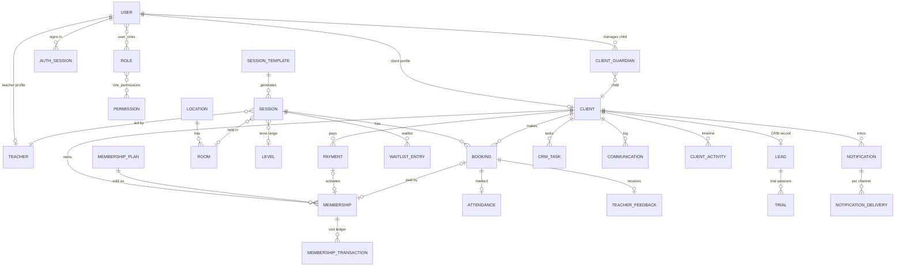

# Database

PostgreSQL 17, accessed through Prisma 6. The schema is `apps/api/prisma/schema.prisma`
(57 tables). Conventions: snake_case tables/columns, UUID keys, money in whole tenge
(`Int`) with a currency code, all timestamps `timestamptz` in UTC.

## Core entities

Other groups: `programs`, `levels`, `group_types`, `lead_sources` (catalog) · `crm_tags`,
`client_tags`, `segments`, `broadcasts`, `broadcast_recipients`, `announcements`,
`automation_rules`, `automation_runs` (marketing) · `notification_templates`,
`push_subscriptions` · `referral_codes`, `referrals` · `legal_documents`,
`agreement_acceptances`, `data_requests` (privacy) · `audit_logs`, `settings`,
`import_jobs`, `file_assets`, `otp_codes`, `booking_reminders`.

## Integrity rules enforced by the database

Prisma can't express these, so they live in
`prisma/migrations/20260930102400_constraints/migration.sql`:

| Constraint | Guarantees |
| --- | --- |
| `sessions_no_room_overlap` (EXCLUDE, btree_gist) | A room can't host two overlapping scheduled sessions |
| `sessions_no_teacher_overlap` (EXCLUDE) | A teacher can't lead two overlapping scheduled sessions |
| `sessions_time_range_chk`, `sessions_capacity_chk` | Sessions end after they start; capacity > 0 |
| `memberships_visits_remaining_chk` | A membership balance can't go negative |
| `membership_transactions_balance_chk` | No ledger entry can leave a negative balance |
| `memberships_period_chk` | A membership expires after it starts |
| `bookings_active_slot_chk` + unique (session, client, active_slot) | A client holds at most one active booking per session (cancelled ones don't count) |
| `bookings_membership_required_chk` | A membership booking always references the membership that paid |
| `waitlist_entries_active_slot_chk` + unique | One active waitlist entry per client per session |
| `payments_amount_chk` | Amounts ≥ 0; refunds can't exceed the payment |
| `teacher_feedback_scores_chk` | Ratings are 1–5 |
| `session_templates_*_chk`, `rooms_capacity_chk`, `membership_plans_values_chk` | Valid times, days and positive values |

The API maps violations to clear error codes (e.g. a room overlap →
`SESSION_ROOM_CONFLICT`), so even a race that slips past application checks ends as a
friendly message, not a 500.

## The visit ledger

`membership_transactions` is append-only: `type` (PURCHASE, GRANT, BOOKING,
CANCELLATION_REFUND, SESSION_CANCELLED_REFUND, ADMIN_RETURN, ADMIN_ADJUSTMENT,
EXTENSION), `delta`, `balance_after`, `reason`, `booking_id`, `created_by_id`, and the
old/new expiry for extensions. `memberships.visits_remaining` mirrors the latest
`balance_after` and is only written by `MembershipLedgerService` inside the same
transaction, under a row lock on the membership.

## Migrations

| Environment | Command |
| --- | --- |
| Development (create + apply) | `npm run db:migrate` (`prisma migrate dev`) |
| Staging / production (apply only) | `npx prisma migrate deploy` (the Docker `migrate` service runs it) |

Migrations in order: `init` → `constraints` → `notification_secondary_button` →
`auth_refresh_grace`. Never edit an applied migration; add a new one.
Prisma's drift detection keeps the custom constraints (verified: a `migrate diff`
against the database produces no changes).

## Demo data (development only)

`apps/api/prisma/seed.ts` replays about five weeks of club life **through the real
services** with a simulated clock — registrations, trial sessions, Kaspi/cash payments,
bookings, on-time and late cancellations, attendance, no-shows, renewals, feedback,
waitlists, CRM activity, announcements and broadcasts — so every balance, ledger entry
and statistic is consistent. Timestamps are then aligned to the simulated timeline.

- `npm run db:seed` — seed an empty database.
- `npm run db:reseed` — wipe and reseed for today's date.

The seed refuses to run when `NODE_ENV` is `production`/`staging` or the database host
isn't local (`localhost`, `127.0.0.1`, `::1`, or the Docker service name `db`).

## Backups

Production backups are covered in [DEPLOYMENT.md](DEPLOYMENT.md#backups). The database is
the only stateful component besides uploaded files (`STORAGE_LOCAL_DIR`).
